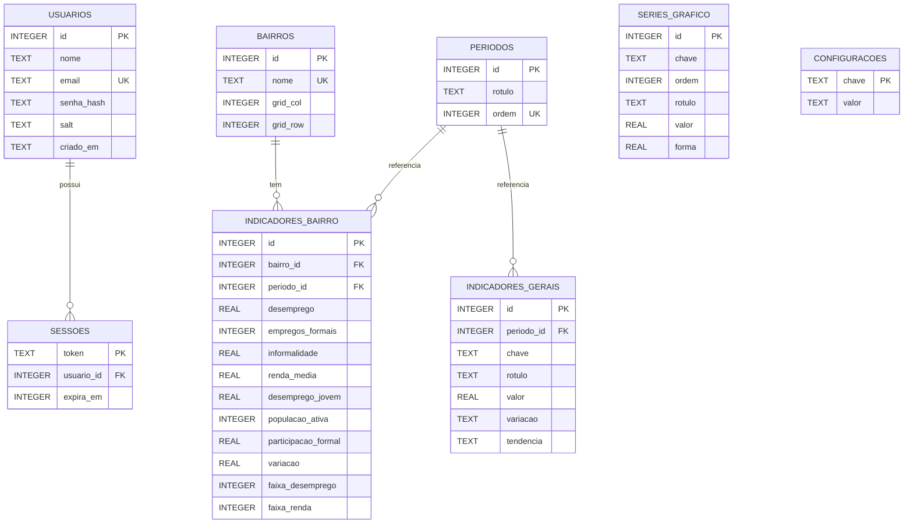

# Modelagem Lógica do Banco de Dados

SGBD: **SQLite** (arquivo `backend/dadosrecife.db`, criado a partir de `schema.sql` + `seed.sql`).

## Diagrama Entidade-Relacionamento

## Modelo lógico (notação textual)

- **usuarios** (<u>id</u>, nome, email, senha_hash, salt, criado_em)
- **sessoes** (<u>token</u>, *usuario_id* → usuarios.id, expira_em)
- **bairros** (<u>id</u>, nome, grid_col, grid_row)
- **periodos** (<u>id</u>, rotulo, ordem)
- **indicadores_bairro** (<u>id</u>, *bairro_id* → bairros.id, *periodo_id* → periodos.id, desemprego, empregos_formais, informalidade, renda_media, desemprego_jovem, populacao_ativa, participacao_formal, variacao, faixa_desemprego, faixa_renda)
- **indicadores_gerais** (<u>id</u>, *periodo_id* → periodos.id, chave, rotulo, valor, variacao, tendencia)
- **series_grafico** (<u>id</u>, chave, ordem, rotulo, valor, forma)
- **configuracoes** (<u>chave</u>, valor)

## Regras e restrições

| Tabela | Restrição | Motivo |
|---|---|---|
| usuarios | `email` UNIQUE | um cadastro por e-mail |
| sessoes | FK `usuario_id` com `ON DELETE CASCADE` | apagar usuário encerra suas sessões |
| bairros | `nome` UNIQUE; `grid_col`/`grid_row` entre 1 e 6 | posição válida no mapa |
| indicadores_bairro | UNIQUE (`bairro_id`, `periodo_id`) | um registro por bairro por período |
| indicadores_bairro | `faixa_*` entre 1 e 5 | cinco faixas de cor da legenda |
| indicadores_gerais | UNIQUE (`periodo_id`, `chave`) | um card de cada tipo por período |
| indicadores_gerais | `tendencia` IN ('alta','baixa','neutra') | define a seta/cor do card |

## Normalização

- **1FN:** todos os atributos são atômicos.
- **2FN:** os indicadores dependem da chave inteira (bairro + período), por isso ficam em `indicadores_bairro` e não em `bairros`.
- **3FN:** dados do bairro (nome, posição) e do período (rótulo, ordem) ficam nas suas próprias tabelas, sem repetição nos indicadores.

> Os valores dos indicadores estão como `'xxx'` nos dados demonstrativos. O SQLite aceita texto em colunas `REAL`/`INTEGER` (tipagem dinâmica), então basta trocar por números reais no `seed.sql`.
