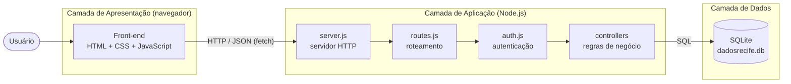
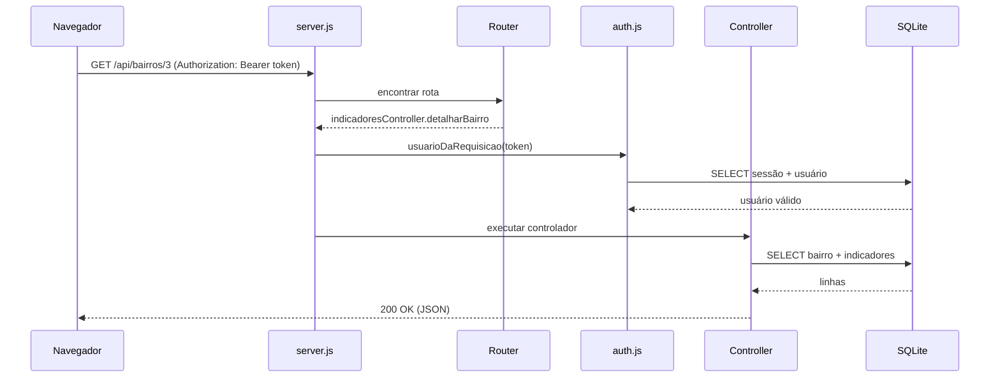

# Documentação Técnica – Arquitetura da Solução

**Projeto:** DadosRecife – Mercado de Trabalho e Renda
**Equipe:** TechMinds

## 1. Visão geral

O DadosRecife é uma aplicação web para consulta territorializada de indicadores de trabalho e renda do Recife. Ela segue a arquitetura **cliente-servidor em três camadas**:



| Camada | Tecnologia | Responsabilidade |
|---|---|---|
| Apresentação | HTML5, CSS3, JavaScript (sem frameworks) | Telas, gráficos em SVG, navegação e chamadas à API |
| Aplicação | Node.js 22.13+ (módulos nativos `http`, `crypto`, `node:sqlite`) | API REST, autenticação, validação e regras de negócio |
| Dados | SQLite | Armazenamento de usuários, sessões, bairros e indicadores |

Não há dependências externas (`npm install` não é necessário).

## 2. Estrutura de pastas

```
TechMinds/
├── backend/
│   ├── server.js                 # ponto de entrada: servidor HTTP
│   ├── scripts/reset-db.js       # recria o banco a partir dos scripts SQL
│   └── src/
│       ├── config.js             # porta, caminho do banco, duração da sessão
│       ├── db.js                 # conexão com o SQLite
│       ├── http.js               # utilitários (JSON, corpo, arquivos estáticos, erros)
│       ├── router.js             # roteador com parâmetros (/api/bairros/:id)
│       ├── routes.js             # tabela de endpoints
│       ├── auth.js               # hash de senha e validação do token
│       └── controllers/
│           ├── authController.js
│           └── indicadoresController.js
├── database/
│   ├── schema.sql                # DDL: criação das tabelas
│   ├── seed.sql                  # DML: inserção dos dados
│   └── modelo-logico.md          # diagrama ER e modelo lógico
├── frontend/
│   ├── login.html                # login e cadastro
│   ├── app.html                  # painel (SPA com 7 páginas)
│   ├── css/style.css
│   └── js/
│       ├── api.js                # cliente da API (fetch + token)
│       ├── login.js
│       └── app.js
└── docs/
    └── arquitetura.md
```

## 3. Fluxo de uma requisição



Erros de validação geram `ErroHttp` com o status adequado (400, 401, 404, 409), tratado em um único ponto no `server.js`.

## 4. Autenticação

1. O usuário envia e-mail e senha para `POST /api/login`.
2. A senha é comparada com o hash **scrypt** + salt guardado em `usuarios` (comparação em tempo constante).
3. O servidor gera um token aleatório de 256 bits, salva em `sessoes` com validade de 8 horas e devolve ao cliente.
4. O front-end guarda o token no `localStorage` e o envia em todas as chamadas no cabeçalho `Authorization: Bearer <token>`.
5. Rotas protegidas retornam **401** sem token válido; o front-end então volta para a tela de login.
6. `POST /api/logout` apaga a sessão do banco.

## 5. Endpoints da API

| Método | Rota | Autenticação | Descrição |
|---|---|---|---|
| POST | `/api/login` | não | Body `{email, senha}` → `{token, usuario}` |
| POST | `/api/cadastro` | não | Body `{nome, email, senha}` → 201 |
| POST | `/api/logout` | sim | Encerra a sessão |
| GET | `/api/me` | sim | Dados do usuário logado |
| GET | `/api/visao-geral` | sim | Cards, mapa, evolução e top 5 |
| GET | `/api/bairros` | sim | Lista de bairros |
| GET | `/api/bairros/:id?periodo=` | sim | Indicadores de um bairro |
| GET | `/api/mapa?indicador=&periodo=` | sim | Faixas de cor por bairro (`renda`, `desemprego`, `empregos`, `informalidade`) |
| GET | `/api/periodos` | sim | Períodos disponíveis |
| GET | `/api/comparar?b1=&b2=` | sim | Comparação entre dois bairros |
| GET | `/api/info` | sim | Data da última atualização |
| GET | `/api/download` | sim | CSV com os indicadores |

Respostas de erro seguem o formato `{"erro": "mensagem"}`.

## 6. Banco de dados

Modelo completo em [`database/modelo-logico.md`](../database/modelo-logico.md). Resumo:

- `usuarios` 1:N `sessoes`
- `bairros` 1:N `indicadores_bairro` N:1 `periodos`
- `periodos` 1:N `indicadores_gerais`
- `series_grafico` e `configuracoes` são tabelas de apoio

Na primeira execução o servidor cria `backend/dadosrecife.db` rodando `schema.sql` e `seed.sql`. O comando `npm run db:reset` recria o banco.

## 7. Boas práticas aplicadas

- **Separação de responsabilidades:** rotas, controladores, autenticação, acesso a dados e utilitários em módulos próprios.
- **Segurança:** senhas com hash scrypt + salt; consultas SQL parametrizadas (`?`) contra SQL injection; tokens aleatórios com expiração; proteção contra *path traversal* nos arquivos estáticos; escape de HTML no front-end contra XSS.
- **Integridade dos dados:** chaves estrangeiras, `UNIQUE` e `CHECK` no banco.
- **Tratamento de erros centralizado** com códigos HTTP corretos.
- **Configuração por variáveis de ambiente** (`PORT`, `DB_FILE`).
- **Versionamento:** Git, com o banco gerado ignorado no `.gitignore` (é recriado pelos scripts).

## 8. Limitações e próximos passos

- Os valores dos indicadores são demonstrativos (`xxx`) e serão substituídos por fontes oficiais.
- O mapa usa uma grade ilustrativa; uma evolução seria usar os polígonos reais dos bairros (GeoJSON).
- Para produção: HTTPS, limite de tentativas de login e um SGBD servidor (PostgreSQL).
